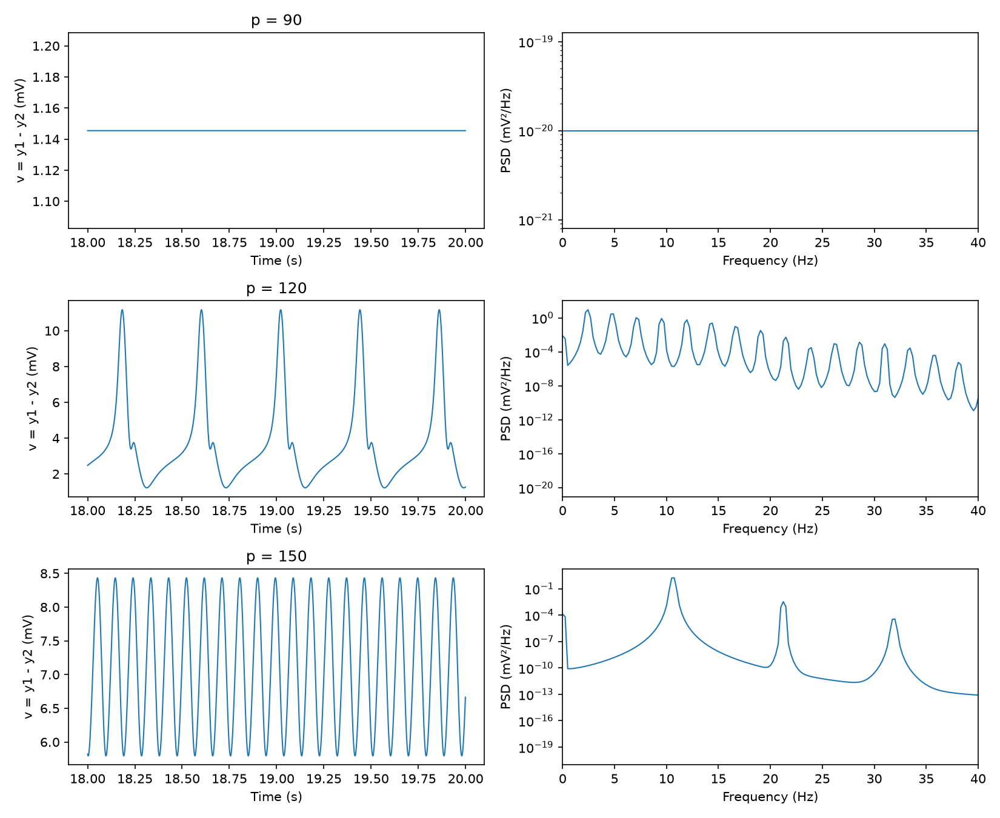

# Constant input to a single Jansen–Rit column: amplitude, frequency and dependence on starting state

## Abstract

This project looks at how constant external input p changes the output amplitude and dominant frequency of a single-column Jansen–Rit neural mass model, with every other parameter at the Jansen & Rit (1995) values. Starting from rest, p = 90 gives a flat output, p = 120 a large, slow, spike-like oscillation (9.94 mV peak-to-peak, 2.44 Hz) and p = 150 a smaller, nearly sinusoidal one (2.65 mV, 10.74 Hz). A longer settling check, stricter tolerances and a different integrator did not change these results. The main caveat is that they depend on the starting state: at p = 120, starting from the end state of the p = 150 run gives a different stable oscillation (2.07 mV, 10.50 Hz).

## Background

Neural mass models describe the average activity of a neural population with a small set of differential equations. The Jansen–Rit model is a compact, widely used example that produces EEG-like rhythms. I used constant input so that every run is deterministic. Jansen & Rit used random input, so this is a deliberate simplification.

## Model

The column has three populations: pyramidal cells, excitatory interneurons and inhibitory interneurons. Each synaptic connection is a second-order filter with two states (potential and rate of change), giving six states. External input p adds excitation to the pyramidal cells and appears in one equation only (the one for y4). The output is v = y1 − y2, the net pyramidal membrane potential. Parameters are the standard values (A = 3.25 mV, B = 22 mV, a = 100 s⁻¹, b = 50 s⁻¹, C = 135, e0 = 2.5 s⁻¹, v0 = 6 mV, r = 0.56 mV⁻¹). The output is the model's population signal, not a simulated scalp recording.

## Methods

I used p = 90, 120 and 150 s⁻¹. Each run integrated 20 s from an all-zero state with SciPy `solve_ivp` (RK45, rtol 1e-6, atol 1e-8, maximum step 1 ms), sampled on a fixed 1000 Hz grid, and the first 5 s were excluded. Spectra used Welch's method (4096-sample segments, resolution about 0.24 Hz); the peak frequency is the largest bin between 1 and 40 Hz. An output counts as oscillating if its peak-to-peak range exceeds 0.1 mV (a practical threshold, not a standard); otherwise no peak frequency is reported. Three checks were run:

1. Transient: peak-to-peak in 5–10 s versus 15–20 s, with a 5% tolerance.
2. Solver: stricter RK45 tolerances and LSODA, counted as agreeing if the regime matches, amplitude is within 1% and peak frequency is within one bin.
3. Initial conditions: each p started from zeros and from the final states of the p = 90 and p = 150 runs, analysing the last 20 s of 60 s.

## Results

Baseline results (`results/baseline/summary.csv`):

| p (s⁻¹) | Oscillating | Peak-to-peak (mV) | Peak frequency (Hz) |
| --- | --- | --- | --- |
| 90 | no | 0.000 | not reported |
| 120 | yes | 9.944 | 2.44 |
| 150 | yes | 2.646 | 10.74 |

*Figure 1. Last 2 s of output and power spectra for each p.*

Amplitude is not monotonic in p, and the waveform changes abruptly: slow sharp spikes with harmonics at p = 120, a near-sinusoid at p = 150.

Transient (`results/transient_check.csv`): the early and late amplitudes differed by 0% at p = 90 and 120 and by 0.24% at p = 150, so the 5 s exclusion was adequate.

Solver (`results/solver_comparison.csv`): both alternative settings met all three criteria at every p.

Initial conditions (`results/initial_conditions.csv`, `results/initial_conditions.png`):

| p | start: zeros | start: end of p = 90 | start: end of p = 150 |
| --- | --- | --- | --- |
| 90 | flat | flat | 0.359 mV, 10.25 Hz (see below) |
| 120 | 9.944 mV, 2.44 Hz | 9.944 mV, 2.44 Hz | 2.065 mV, 10.50 Hz |
| 150 | 2.640 mV, 10.74 Hz | 2.640 mV, 10.74 Hz | 2.640 mV, 10.74 Hz |

At p = 120 both oscillations persisted unchanged for 300 s (`results/long_settling.csv`), so two stable behaviours coexist there. At p = 90, from the p = 150 end state, the oscillation was still shrinking after 300 s (0.65 to 0.20 mV across 20 s windows). That suggests a slow decay, but the run was not long enough to show it, so whether p = 90 is also bistable is unresolved. Part of the difference between conditions therefore reflects the starting state, not only p.

## Limitations

One model, three input values, constant input. No real EEG and no stimulation modelling. The 0.1 mV threshold and the 1–40 Hz band are my choices. There is no formal bifurcation analysis, so the regime boundaries and the slow decay at p = 90 are not established.

## References and code

- Jansen, B. H., & Rit, V. G. (1995). *Biological Cybernetics, 73*(4), 357–366.
- Grimbert, F., & Faugeras, O. (2006). *Neural Computation, 18*(12), 3052–3068.
- Code and outputs: this repository (`simulate_jr.py`, `check_*.py`, `results/`). Citation details should be checked against the originals.
